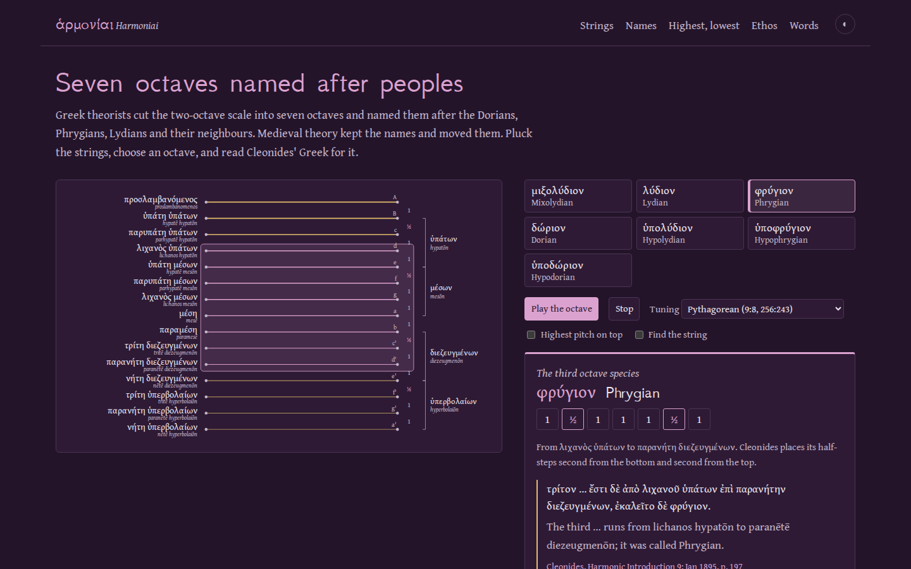
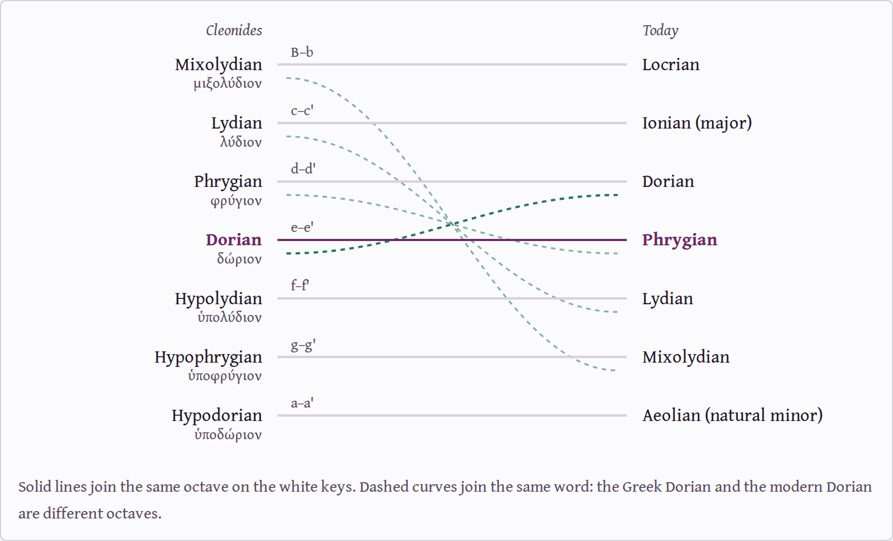

# Harmoniai

**Hear the seven Greek octave species, read Cleonides' Greek for each, and see how their regional names moved.**

[](LICENSE)
[](https://antonsoo.github.io/harmoniai/)



Dorian, Phrygian and Lydian are the names of peoples: the Dorians of the Peloponnese,
the Phrygians and Lydians of Anatolia. Greek theorists named musical scales after
them, and the same Greek adverb, Δωριστί, means "in the Dorian dialect" and "in the
Dorian mode". Medieval theory kept the names and moved them. The scale a music student
learns as "Dorian" today is the one Cleonides called Phrygian. His Dorian is today's
Phrygian.

Harmoniai lays out the fifteen strings of the Greek two-octave system, names each
string as the Greeks did, and lets you pluck them. Choose one of Cleonides' seven
octaves to see where it sits, hear it, read his sentence for it, and see what it is
called now.

**[Open it](https://antonsoo.github.io/harmoniai/)**

## What is on the page

- **The strings, as named.** ὑπάτη means "highest", and LSJ defines the string as "the
  highest of the three strings … but the lowest in pitch". The page draws it on top, as
  the name says; a switch turns the instrument the modern way up. Each string carries its
  name and literal meaning: λιχανός, the string "struck with the forefinger", comes from
  λείχω, "lick".
- **Seven octaves.** Cleonides, *Harmonic Introduction* 9, defines each octave species
  by its first and last string ("from hypatē mesōn to nētē diezeugmenōn") and adds what
  "the ancients" called it. Play it in Pythagorean tuning (9:8 tones, 256:243 half-tones)
  or Aristoxenus's equal tones and half-tones.
- **The names moved.** A diagram joins each of Cleonides' names to the modern name of
  the same white-key octave, and each shared word to its new octave.

  

- **What a harmonia does to you.** Plato's *Republic* (398e–399a) and Aristotle's
  *Politics* (1340a40–b5) in Greek and English. Glaucon tells Socrates he is left with
  Dorian and Phrygian, and Socrates answers "I don't know the harmoniai".
- **Words of the strings.** ἁρμονία first means a carpenter's joint (Odysseus's raft),
  then the stringing of a lyre. τόνος, "tone", is a stretched cord. ἡμιτόνιον, "semitone",
  also names half the twisted spring of a torsion catapult, and Vitruvius tells architects
  to learn music so they can tune those springs by ear (I.1.8).
- **Find the string.** Names disappear from the strings; pluck the one asked for. Missed
  strings come back sooner.

## Cleonides checks himself

Cleonides describes each octave twice. First by name: the Dorian runs "ἀπὸ ὑπάτης
μέσων ἐπὶ νήτην διεζευγμένων". Then, in the diatonic, by where its two half-steps fall:
"first at the low end and third at the high end". The test suite parses the first
description from the Greek quoted on the page and finds the strings it names. It derives
the half-step positions from the system, and checks them against the second description.
All seven agree. They come out as the seven white-key octaves B–b through A–a, and four
of them now carry a different octave's name.

| Cleonides | Strings | White keys | Called today |
|---|---|---|---|
| Mixolydian, μιξολύδιον | hypatē hypatōn – paramesē | B–b | Locrian |
| Lydian, λύδιον | parhypatē hypatōn – tritē diezeugmenōn | C–c | Ionian (major) |
| Phrygian, φρύγιον | lichanos hypatōn – paranētē diezeugmenōn | D–d | Dorian |
| Dorian, δώριον | hypatē mesōn – nētē diezeugmenōn | E–e | Phrygian |
| Hypolydian, ὑπολύδιον | parhypatē mesōn – tritē hyperbolaiōn | F–f | Lydian |
| Hypophrygian, ὑποφρύγιον | lichanos mesōn – paranētē hyperbolaiōn | G–g | Mixolydian |
| Hypodorian, ὑποδώριον (also "common" and Locrian) | mesē – nētē hyperbolaiōn | A–a | Aeolian (natural minor) |

## Sources

- Cleonides, *Harmonic Introduction*, in K. von Jan, *Musici scriptores Graeci*
  (Leipzig: Teubner, 1895), pp. 197–198, read from the page images of the Internet
  Archive scan `musiciscriptoresjank`. Jan's own table gives the same letters.
- Plato, *Republic*, ed. Burnet (1903), and Aristotle, *Politics*, ed. Ross (1957), as
  published by the Perseus Digital Library.
- Senses from LSJ through Logeion. Two note names, παραμέση and τρίτη, have no separate
  LSJ entry; their glosses are readings of the compounds and say so.
- Glarean's *Dodecachordon* (1547) is mentioned only for what is uncontroversial: it
  extended the church modes to twelve and added Aeolian and Ionian.

## How it works

Vite and TypeScript, no framework. `src/core/system.ts` holds the fifteen strings, the
step pattern and Cleonides' species with both of his descriptions. The instrument is
hand-written SVG. Sound is a Karplus–Strong plucked string synthesized in the browser:
a burst of noise in a delay line one period long, smoothed on each pass. It sounds like a
plucked string, not like any particular ancient instrument. There are no network requests
after load and no tracking, and the fonts (GFS Neohellenic, Gentium Book Plus) are
self-hosted.

Tests (`npm test`, 14):

- Cleonides' two descriptions agree;
- the system spans exactly two octaves, with a 4:3 fourth under the mesē, a 3:2 fifth
  above it and a 9:8 tone of disjunction;
- the four shared names land on different octaves;
- the synthesized string sounds within 15 cents of its target and dies away;
- the Leitner schedule weights missed strings sixteen times over known ones.

## Run it

```sh
git clone https://github.com/antonsoo/harmoniai.git && cd harmoniai
npm ci
npm run dev        # http://127.0.0.1:4413/harmoniai/
```

`npm run check` runs Biome, strict TypeScript, the tests and the production build.

## Accuracy and limitations

- **Plato's harmoniai may not be Cleonides' octave species.** Plato and Aristotle wrote
  centuries before Cleonides, whose date is uncertain. Whether their harmoniai were the
  same scales is debated; the page shows the shared names and says so.
- **The page shows the diatonic genus only.** Cleonides defines the species in the
  enharmonic first; the chromatic and enharmonic genera, with their smaller steps, are
  not modelled. Pyknon, a sibling project, works with the enharmonic.
- **Neither tuning is a recovered performance.** Pythagorean ratios are one ancient
  theory of tuning, and Aristoxenus measured intervals in tones and parts. Absolute
  pitch (mesē at 220 Hz) is a modern choice.
- **The English translations are new.** They have not been checked by a second reader.

## Related

[Pyknon](https://github.com/antonsoo/pyknon) hears the enharmonic tetrachord and reads
Greek notation. [Embater](https://github.com/antonsoo/embater) does for ancient
buildings what this does for scales.

## License

Code: [MIT](LICENSE). Fonts: SIL Open Font License (`src/fonts/LICENSE.txt`). Quoted
Greek texts are from public-domain editions or Perseus (CC BY-SA 3.0 US); see
[THIRD_PARTY_NOTICES.md](THIRD_PARTY_NOTICES.md).
