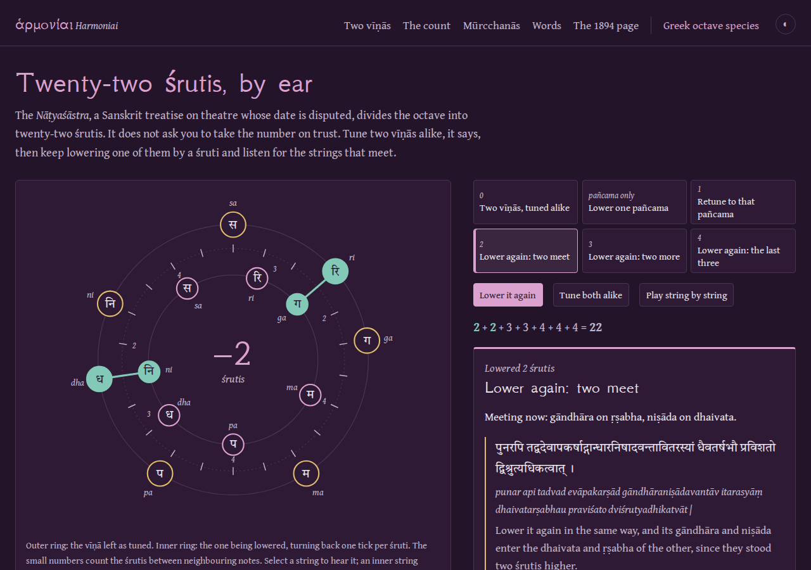
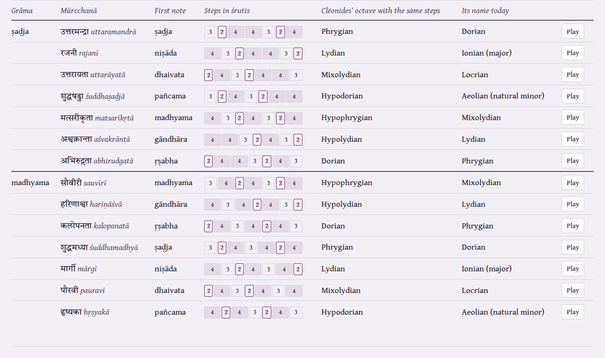

# Harmoniai

**Hear the seven Greek octave species, read Cleonides' Greek for each, and see how their regional names moved. A second page runs Bharata's two-vīṇā demonstration of the twenty-two śrutis from the Sanskrit.**

[](LICENSE)
[](https://antonsoo.github.io/harmoniai/)


Dorian, Phrygian and Lydian are the names of peoples: the Dorians of the Peloponnese,
the Phrygians and Lydians of Anatolia. Greek theorists named musical scales after
them, and the same Greek adverb, Δωριστί, means "in the Dorian dialect" and "in the
Dorian mode". Medieval theory kept the names and moved them. The scale a music student
learns as "Dorian" today is the one Cleonides called Phrygian. His Dorian is today's
Phrygian.

Harmoniai lays out the fifteen strings of the Greek two-octave system, names each
string as the Greeks did, and lets you pluck them. Choose one of Cleonides' seven
octaves to see where it sits, hear it, read his sentence for it, and see what it is
called now.

**[Open it](https://antonsoo.github.io/harmoniai/)**

## What is on the page

- **The strings, as named.** ὑπάτη means "highest", and LSJ defines the string as "the
  highest of the three strings … but the lowest in pitch". The page draws it on top, as
  the name says; a switch turns the instrument the modern way up. Each string carries its
  name and literal meaning: λιχανός, the string "struck with the forefinger", comes from
  λείχω, "lick".
- **Seven octaves.** Cleonides, *Harmonic Introduction* 9, defines each octave species
  by its first and last string ("from hypatē mesōn to nētē diezeugmenōn") and adds what
  "the ancients" called it. Play it in Pythagorean tuning (9:8 tones, 256:243 half-tones)
  or Aristoxenus's equal tones and half-tones.
- **Where the names come from.** A map of the Aegean marks the homes of the Dorians,
  Locrians, Ionians, Lydians and Phrygians, with the Greek adverb for each.
- **The names moved.** A diagram joins each of Cleonides' names to the modern name of
  the same white-key octave, and each shared word to its new octave.

  

- **What a harmonia does to you.** Plato's *Republic* (398e–399a) and Aristotle's
  *Politics* (1340a40–b5) in Greek and English. Glaucon tells Socrates he is left with
  Dorian and Phrygian, and Socrates answers "I don't know the harmoniai".
- **Words of the strings.** ἁρμονία first means a carpenter's joint (Odysseus's raft),
  then the stringing of a lyre. τόνος, "tone", is a stretched cord. ἡμιτόνιον, "semitone",
  also names half the twisted spring of a torsion catapult, and Vitruvius tells architects
  to learn music so they can tune those springs by ear (I.1.8).
- **Find the string.** Names disappear from the strings; pluck the one asked for. Missed
  strings come back sooner.

## Cleonides checks himself

Cleonides describes each octave twice. First by name: the Dorian runs "ἀπὸ ὑπάτης
μέσων ἐπὶ νήτην διεζευγμένων". Then, in the diatonic, by where its two half-steps fall:
"first at the low end and third at the high end". The test suite parses the first
description from the Greek quoted on the page and finds the strings it names. It derives
the half-step positions from the system, and checks them against the second description.
All seven agree. They come out as the seven white-key octaves B–b through A–a, and four
of them now carry a different octave's name.

| Cleonides | Strings | White keys | Called today |
|---|---|---|---|
| Mixolydian, μιξολύδιον | hypatē hypatōn – paramesē | B–b | Locrian |
| Lydian, λύδιον | parhypatē hypatōn – tritē diezeugmenōn | C–c | Ionian (major) |
| Phrygian, φρύγιον | lichanos hypatōn – paranētē diezeugmenōn | D–d | Dorian |
| Dorian, δώριον | hypatē mesōn – nētē diezeugmenōn | E–e | Phrygian |
| Hypolydian, ὑπολύδιον | parhypatē mesōn – tritē hyperbolaiōn | F–f | Lydian |
| Hypophrygian, ὑποφρύγιον | lichanos mesōn – paranētē hyperbolaiōn | G–g | Mixolydian |
| Hypodorian, ὑποδώριον (also "common" and Locrian) | mesē – nētē hyperbolaiōn | A–a | Aeolian (natural minor) |

## Bharata's two vīṇās



The *Nāṭyaśāstra*, a Sanskrit treatise on theatre whose date is disputed, says the octave
holds twenty-two śrutis, and in an obscure, textually insecure passage it says how to hear
that. Tune two vīṇās alike. Lower one
pañcama a śruti, which makes the madhyama-grāma, then retune the rest of that vīṇā to it.
Keep lowering it the same way: after two śrutis its gāndhāra and niṣāda meet the other
vīṇā's ṛṣabha and dhaivata; after three, ṛṣabha and dhaivata meet ṣaḍja and pañcama; after
four, pañcama, madhyama and ṣaḍja meet madhyama, gāndhāra and niṣāda.

`vina.html` turns that paragraph into a dial: the fixed vīṇā on the outer ring, the
lowered one on the inner ring, each step with its Sanskrit (Devanagari and IAST) and a
new translation. Select a string to hear it; an inner string sounds together with the
nearest outer one, so meetings are unisons.

What the model shows:

- **The count is exact.** The meetings computed from the two grāmas (NS 28.25–29) are the
  ones the prose names, at the lowerings it names, and nothing else meets. The lowerings
  at which the seven notes meet add up to 2+2+3+3+4+4+4 = 22. Joanny Grosset made this
  sum in 1888 (note 36), while calling the passage obscure; the dial makes it playable.
- **Equal lowerings are an extra assumption.** This dial uses one equal interval at
  every successive lowering. Under that assumption the unit is 1200/22 = 54.5 cents,
  with fourth and fifth at 490.9 and 709.1 cents. The text's meetings alone do not force
  this: Bel's analysis allows unequal lowerings. One pure-fourth/fifth preparation
  uses successive moves of 21.506, 90.225, 70.672 and 21.506 cents, preserving the same
  meetings. The page compares both cumulative sequences, plays their fifths with
  sine tones, and links to [Pyknon's operable alternative](https://antonsoo.github.io/pyknon/vina.html).
- **The seven ṣaḍja-grāma mūrcchanās are Cleonides' seven octave species.** Counting
  only tones and half-tones, Bharata's list (from ṣaḍja, niṣāda, dhaivata, … down to
  ṛṣabha) gives Phrygian, Lydian, Mixolydian, Hypodorian, Hypophrygian, Hypolydian and
  Dorian in that order. The madhyama-grāma's seven repeat the same orders with the
  three- and four-śruti tones in different places.

  

- **The witnesses disagree exactly where the arithmetic bites.** The 1894 Kāvyamālā
  chapter is taken over from Grosset's 1888 edition (its footnote on p. 301 says so), and
  Grosset printed the whole demonstration in brackets as doubtful. The same 1894 scan also
  holds an earlier setting of those pages, without the footnote: its demonstration has
  no three-śruti lowering, as Grosset's manuscript G has a lacuna there. Without that
  stage the meetings measure only 16 of the 22 śrutis, so the count needs the stage that,
  of Grosset's two manuscripts, only A keeps. In Grosset's text that stage reads *śrutyadhikatvāt*, "a śruti
  higher", where the count needs three (Ghosh's 1961 translation supplies "[three]"), and
  the second lowering names its pairs crosswise, *gāndhāra-niṣāda* into
  *dhaivata-ṛṣabha*. The earlier 1894 setting has *ṛṣabha-dhaivata*, the order the count
  needs.

Fifteen Sanskrit words with Monier-Williams senses sit below: a note (gāndhāra) and two
mūrcchanās (sauvīrī, pauravī) share their names with peoples, as the Greek harmoniai do, and
madhyama is "middle", like μέση.

## Sources

- Cleonides, *Harmonic Introduction*, in K. von Jan, *Musici scriptores Graeci*
  (Leipzig: Teubner, 1895), pp. 197–198, read from the page images of the Internet
  Archive scan `musiciscriptoresjank`. Jan's own table gives the same letters.
- Plato, *Republic*, ed. Burnet (1903), and Aristotle, *Politics*, ed. Ross (1957), as
  published by the Perseus Digital Library.
- Senses from LSJ through Logeion. Two note names, παραμέση and τρίτη, have no separate
  LSJ entry; their glosses are readings of the compounds and say so.
- Bharata, *Nāṭyaśāstra* 28 and 29, ed. Śivadatta and K. P. Parab, Kāvyamālā 42
  (Bombay: Nirṇaya Sāgara Press, 1894), pp. 301–305 and 328, transcribed from the page
  images of the Internet Archive scan
  `natyasastrakasinathpandurangparabpanditsivadattanirnayasagarpresskm42mula`, not from
  its OCR. Chapter 28 there follows Grosset's edition; the scan's earlier setting of
  pp. 297–304 is at physical PDF pages 300–307.
- J. Grosset, *Contribution à l'étude de la musique hindoue* (Paris: Leroux, 1888),
  pp. 21, 28–29 and 86, read from the page images that the sibling project Grāma bundles. Manomohan Ghosh's translation (Calcutta: Asiatic Society, 1961) was consulted
  for comparison and is cited only for two bracketed or translated words.
- Sanskrit senses from Monier-Williams, *A Sanskrit-English Dictionary* (1899), through
  the Cologne Digital Sanskrit Dictionaries.
- Bernard Bel, *A Mathematical Discussion of the Ancient Theory of Scales According
  to Natyashastra* (1984; revised 1988 and 2020), printed pp. 4–7 and 16–17.
  [Author-hosted paper](https://bolprocessor.org/wp-content/uploads/Bharata-paper.pdf).
- Glarean's *Dodecachordon* (1547) is mentioned only for what is uncontroversial: it
  extended the church modes to twelve and added Aeolian and Ionian.

## How it works

Vite and TypeScript, no framework. `src/core/system.ts` holds the fifteen strings, the
step pattern and Cleonides' species with both of his descriptions. The instrument is
hand-written SVG. Sound is a Karplus–Strong plucked string synthesized in the browser:
a burst of noise in a delay line one period long, smoothed on each pass. It sounds like a
plucked string, not like any particular ancient instrument. There are no network requests
after load and no tracking. Coastlines are cut from Natural Earth (public domain) by
`scripts/aegean.py`. The fonts (GFS Neohellenic, Gentium Book Plus, Tiro Devanagari
Sanskrit) are self-hosted. `src/core/sruti.ts` holds the two grāmas, the stages of the
demonstration and the fourteen mūrcchanās; `src/content/natya.ts` the Sanskrit.

Tests (`npm test`, 20):

- Cleonides' two descriptions agree;
- the system spans exactly two octaves, with a 4:3 fourth under the mesē, a 3:2 fifth
  above it and a 9:8 tone of disjunction;
- the four shared names land on different octaves;
- the synthesized string sounds within 15 cents of its target and dies away;
- the Leitner schedule weights missed strings sixteen times over known ones;
- both grāmas hold 22 śrutis, and the two-vīṇā model meets exactly the strings the
  Sanskrit names at each lowering; without the three-śruti stage it measures only 16;
- Bharata's consonant and dissonant examples are nine, thirteen or twenty śrutis apart;
- the ṣaḍja-grāma mūrcchanās match the seven Greek species in the order above;
- exact integer cross-products verify that a pure-ratio counterexample has the same
  seven meetings under unequal lowerings, with no extra principal-note meetings.

## Run it

```sh
git clone https://github.com/antonsoo/harmoniai.git && cd harmoniai
npm ci
npm run dev        # http://127.0.0.1:4413/harmoniai/
```

`npm run check` runs Biome, strict TypeScript, the tests and the production build.
The footer reports offline readiness only when a controlling worker has the
complete edition. Both pages, fonts and local models then reload without a
connection; external scans and scholarly links remain online resources.
[Publication review and model correction](docs/publication-review.md).

## Accuracy and limitations

- **Plato's harmoniai may not be Cleonides' octave species.** Plato and Aristotle wrote
  centuries before Cleonides, whose date is uncertain. Whether their harmoniai were the
  same scales is debated; the page shows the shared names and says so.
- **The page shows the diatonic genus only.** Cleonides defines the species in the
  enharmonic first; the chromatic and enharmonic genera, with their smaller steps, are
  not modelled. Pyknon, a sibling project, works with the enharmonic.
- **Neither tuning is a recovered performance.** Pythagorean ratios are one ancient
  theory of tuning, and Aristoxenus measured intervals in tones and parts. Absolute
  pitch (mesē at 220 Hz) is a modern choice.
- **Equal śrutis are a modern model.** The text gives a count of śrutis, not their sizes.
  The page chooses twenty-two equal ones to illustrate the count. Unequal successive
  lowerings can give the same named meetings; equality is not forced by the passage.
- **The mūrcchanā match counts tones, not their sizes.** Bharata distinguishes three-
  and four-śruti tones; Cleonides' diatonic does not. The page does not claim either
  tradition learned the scheme from the other.
- **The English translations are new.** They have not been checked by a second reader,
  and the Sanskrit transcription has not been checked by a Sanskritist.

## Related

[Pyknon](https://github.com/antonsoo/pyknon) hears the enharmonic tetrachord and reads
Greek notation. [Grāma](https://github.com/antonsoo/grama) works through the single
pañcama-lowering and the count verses from Grosset's pages, and leaves the two-vīṇā
demonstration aside as doubtful. [Sammû](https://github.com/antonsoo/sammu) follows a
Babylonian retuning procedure through seven named tunings. [Embater](https://github.com/antonsoo/embater) does for ancient
buildings what this does for scales.

## License

Code: [MIT](LICENSE). Fonts: SIL Open Font License (`src/fonts/LICENSE.txt`). Quoted
Greek and Sanskrit texts are from public-domain editions or Perseus (CC BY-SA 3.0 US); see
[THIRD_PARTY_NOTICES.md](THIRD_PARTY_NOTICES.md).
