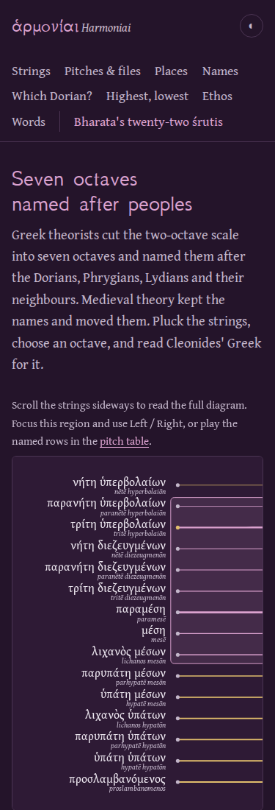
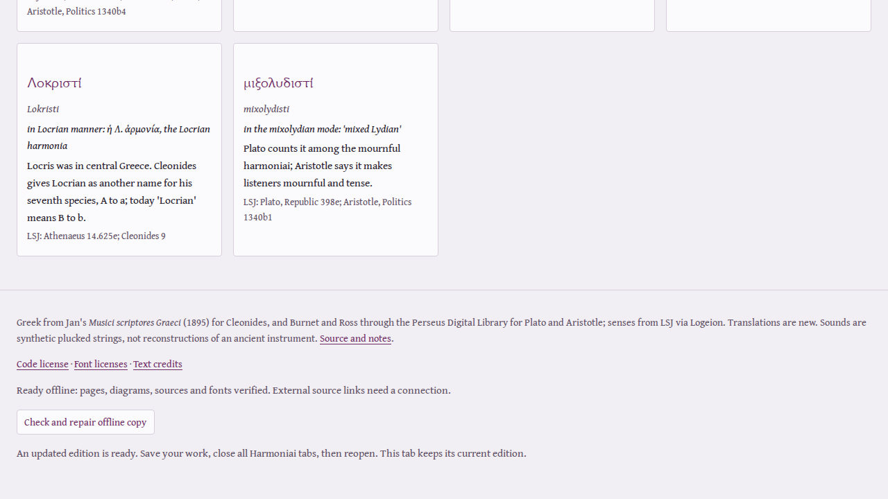

# A saved study must survive the next edition

This audit began by substituting one valid source image for another in the
browser cache. The old worker still reported “Ready offline”; the source reader
correctly refused the image. Deleting the code license then left an incomplete
copy with no repair action. A genuine synthetic update changed the license's
whitespace and its expected hash: both engines deleted the old cache immediately,
and Firefox's already-open octave could no longer save its illustrated study.
Chromium happened to save successfully in that run. These are separate observations,
not an assertion that every update failed in every browser.

The corrected worker verifies the body of every known file, using the exact
length and SHA-256 generated from the build. Checks remove damaged copies and
invalidate ready messages in every open app tab. The footer offers an explicit
repair; a failed repair keeps the learner's current selections. Retrying a failed
first installation registers the worker again, because the browser may have
removed the failed registration.

```
Current tab -> verified current HTML, scripts, fonts and source pages
                         |
New worker installs -> verifies a separate collection -> waits
                         |
           all old application tabs close
                         |
           new worker activates -> old cache is retired
```

Known pages use their verified edition, including when the origin has newer
HTML or now returns an error. Unknown URLs keep their real network response;
they are not replaced by an unrelated index page. Missing known files must be
fetched and verified; an unavailable missing page returns an explanatory 503.
This deliberately replaces the previous navigation policy, which could mix new
HTML with an old worker. Closing all Harmoniai tabs permits the next edition to
activate naturally. No forced takeover discards an open study's source identity.

The migration review also begins with the actual published source `c00cc4d`,
rather than assuming that every visitor already uses the new protocol. The old
mode-name study stays byte-identical while the update waits. If the legacy
worker supplies new HTML before takeover, the new footer refuses an offline-ready
claim and disables the incompatible repair request. It explains how to retain
settings and reopen. After all old tabs close, the new edition activates and
reloads offline.

## Slow progress, stalled bodies and cancellation

Both the source reader and worker distinguish fifteen seconds without any body
progress from a slow download. A file has a separate three-minute deadline;
the worker's full repair has a four-minute bound. Background jobs use three
runners, preserve already verified files, and share a transfer with controlled
foreground readers requesting the same missing asset. File-size bounds prevent
an unexpected response from consuming unbounded memory.

The transfer review imposes one 128,000-byte/s budget across **all** HTTP requests,
including cold installation and a simultaneous source reading. Source transfers
lasted roughly 21–26 seconds in both engines and completed. A body that sent
1,024 bytes and stopped failed after about fifteen seconds; restoring the server
allowed a retry. Direct source requests were tested without worker interception: selecting a
different source page closed the held old body. Cancelling an illustrated
reading also closed its held source request and produced no download. The current selection remained available.

The source reader checks each retained scan before display and every source/font
before embedding. The three original Internet Archive JPEGs were downloaded
again for this review and matched the retained bytes for printed pp. 197–199.
I inspected those complete pages, including the continuation of Dorian, the
Hypophrygian endpoints, the half-step positions and the critical apparatus.
This verifies the edition identity and the displayed excerpts; it is not an
independent philological review of the new English translations.

## What the learner sees

Open the [named-pitch instrument](https://antonsoo.github.io/harmoniai/?species=6&mese=330&selected=12&orientation=pitch#pitches).
Keep mesē at 330 Hz and select τρίτη ὑπερβολαίων. Its ratio-model pitch is
521.4815 Hz; compare the same named string in the equal-step model at 523.8423 Hz.
Change the reference and inspect what stays fixed. Save the illustrated octave,
then reopen it without the site. The file retains the Greek span, all fifteen
measurements and the complete printed evidence.


The instrument previously marked every small step as “½”, including in its ratio
model. It now uses T/S and shows the chosen sizes. In that model T is 203.910
cents and S is 90.225; two S steps are 23.460 cents smaller than T. Switching to
the equal-step teaching model displays 200/100 cents and equality. The saved
study carries the same distinction. These numbers describe our explicit models,
not a newly recovered ancient tuning.

At 375 pixels the old scaled drawing produced very small string targets. The
phone instrument now scrolls horizontally with readable Greek and row targets
above 24 pixels. The scroll region works with the keyboard and the pitch table
remains another way to operate all fifteen named positions. The silver/purple
codex and gold selected string remain the visual identity.

The saved readings retain the complete MIT and Gentium Book Plus notices.
They no longer append licenses for unused GFS or Tiro fonts. The octave's actual
A4 PDF is nine pages rather than fourteen; all notices were found in the extracted
PDF text, and every page was visually inspected. The comparison export now
prints its complete notices as well. Printed headings stay with the following
reading instead of being stranded at the foot of the preceding page.





A [subsequent responsiveness audit](preparation-review.md) lets Stop interrupt
live preparation, reuses repeated pitches, and repeats the rendered-output check.

## Audio at the browser's render thread

Scheduled buffers alone missed another defect. In the original Firefox captures,
the first pluck arrived later than its requested onset while subsequent notes
matched. Synchronous preparation can leave `currentTime` as an old main-thread
snapshot. Playback now yields after preparing the buffers, checks that the action
still owns playback, then selects its start time from the refreshed clock.
Stop or a newer action can cancel the prepared sequence during that handoff.

A pass-through AudioWorklet records the actual digital mix before the physical
device. The independent NumPy oracle uses a direct damped harmonic sum, literal
ratio/key tables and the observed source start times. It does not import our
synthesizer. The review covers both engines at 44,100 and 48,000 Hz, complete
fifteen-note ascending/descending octaves in both models, Stop and tuning changes,
the Indian pure/equal fifths, and the native HTML audio player.

| Digital observation | Final measurement |
| --- | --- |
| Full octave mix, 8 captures | Maximum absolute sample error 0.000000110 |
| Stop or tuning change, 8 captures | Remaining observed samples are exactly zero after a 512-frame allowance |
| Pure/equal fifths, 8 captures | Maximum measured pitch error 0.003146 cents |
| Native media, 2 captures / 32 measured tones | Maximum pitch error 0.000358 cents |
| Native media waveform | RMS residual below 0.000003 after one alignment |

The oscillator fit measures both frequencies with free phases, because the
engines differ at the sub-sample phase boundary. The native player's waveform
uses its actual downloaded PCM as the reference. These are digital observations;
no speaker, microphone, human listening or ancient performance was measured.

The recorder itself was audited. Its first batched implementation lost timing
inside a batch, so it now retains each render quantum. Chromium occasionally
reports the preceding quantum's `currentFrame` for one block, bracketed by
otherwise consecutive labels. The final capture had three such isolated labels.
The recorder marks those corrections and preserves **every sample in order**;
the oracle still checks every octave sample against the independently timed
formula. It does not interpolate, drop samples or relax the waveform tolerance.
Unexplained clock gaps during sound fail the oracle. Initial silent startup gaps
are recorded separately. The earlier rejected receipts remain available in the
review so the accepted measurement does not hide the instrument's limitations.

[Audio-thread operation and timestamps](review/edition-audit/live-output.json) ·
[Independent output measurements](review/edition-audit/live-output-oracle.json) ·
[Rejected initial timestamp receipt](review/edition-audit/live-output-rejected.json).

## Reproduce

Use Node 24 or later, the installed Playwright Chromium and Firefox, and Python
with NumPy for the independent audio calculations. Reviews serve frozen build
bytes, so a later rebuild cannot silently mix editions inside a run.

```sh
npm ci
npm run check
node scripts/edition-fixture.mjs /tmp/harmoniai-next-edition
node scripts/edition-review.mjs dist /tmp/harmoniai-next-edition/dist /tmp/harmoniai-edition-review
node scripts/transfer-review.mjs /tmp/harmoniai-transfer-review
node scripts/offline-review.mjs /tmp/harmoniai-offline-review.json
node scripts/octave-review.mjs /tmp/harmoniai-octave-review
python3 scripts/octave-oracle.py /tmp/harmoniai-octave-review
node scripts/live-output-review.mjs /tmp/harmoniai-live-output
python3 scripts/live-output-oracle.py /tmp/harmoniai-live-output
```

The fixture is explicitly synthetic: it changes a retained license's whitespace
and updates the expected source hash before making a genuine second build.
Never publish that fixture. The migration review accepts a built legacy edition,
current build and external output directory as its three arguments.

## Public edition: 1 November 2026

The reviewed application is published from source `4d80c74`; its build inputs
are unchanged from the clean source `ceac9cc`. A fresh Node 24.22.1 installation
passed `npm ci` and `npm run check`, including 27 tests. All **37 canonical hosted
files** match that clean build byte for byte. The previous source's 36 build
files were also compared with the actual prior published branch, supporting
the legacy migration review's starting point.

Chromium and Firefox at 1440 and 375 pixels operated the **real public site**:
model changes, keyboard plucks, phone scrolling, actual illustrated downloads,
embedded source-image identities, standalone opening without external requests,
and all three rooms after going offline. Each online/offline study pair was
byte-identical. The canonical public entry was rechecked after every context.
Eight pinned anonymous GitHub raw artifacts, including both new PDF and HTML
studies, matched their local files.

[Hosted files and public journeys](review/edition-audit/public-browser.json) ·
[Clean build](review/edition-audit/clean-build.json) ·
[Pinned raw artifacts](review/edition-audit/source-publication.json) ·
[Publication boundary](review/edition-audit/publication.json).

The normal-history Pages commit `88c0616` deployed successfully
([deployment](https://github.com/antonsoo/harmoniai/actions/runs/41364001075)).
The source [CI run](https://github.com/antonsoo/harmoniai/actions/runs/41363945357)
returned failure with an empty steps list; it ran no checks. The local checks,
public bytes and browser observations above are separate evidence. Build command:
`npm run build`; complete output: `dist/`, base `/harmoniai/`. No package release,
tag or physical audio measurement is claimed.
