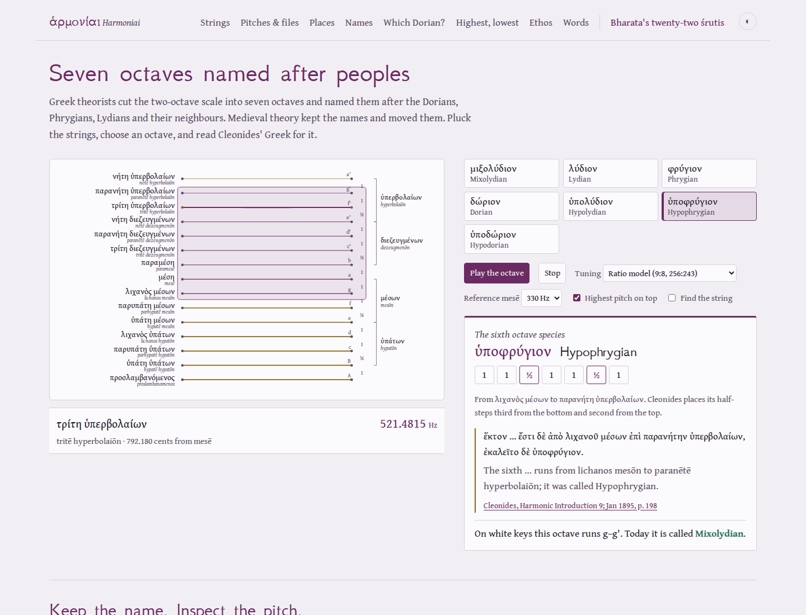
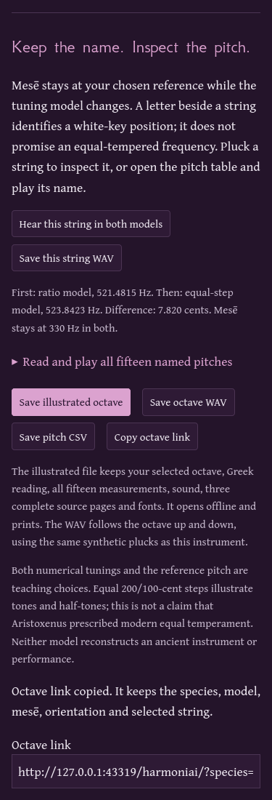

# A name does not fix a frequency

The feature-source observations below are retained for revision `49b6ca0`.
A [subsequent independent audit](edition-audit.md) corrects first-note timing,
ratio-model step labels, phone target sizes, print layout and offline repair.
That report identifies the newer artifacts and publication separately.

The main instrument now lets a learner retain a named string, keep mesē fixed,
and compare two explicitly stated pitch realizations. This also corrects a
signal problem: the old integer-delay synthesis could shift its requested
pitch by more than the model difference the learner was trying to hear.

## Try the actual work

Run `npm ci`, `npm run build`, then `npm run preview`. Open the main Greek
instrument at `http://127.0.0.1:4413/harmoniai/`.

1. Keep the reference mesē at 220 Hz. Pluck **τρίτη ὑπερβολαίων** (tritē
   hyperbolaiōn), or play it from the fifteen-row pitch table.
2. Compare that same string in both models: 347.6543 Hz in the ratio model,
   then 349.2282 Hz in the equal-step realization. The difference is about
   7.820 cents; mesē remains 220 Hz in both.
3. Change mesē to 330 Hz. The same comparison becomes 521.4815 versus
   523.8423 Hz; its interval difference stays the same. The reference is an
   explicit modern choice, not a recovered ancient pitch or concert standard.
4. Select Hypophrygian. Keep its named span and Greek reading, measurements,
   diagram and complete printed pages as an illustrated HTML study. Its WAV
   ascends through eight notes and descends through seven, with overlapping
   pluck tails. Save the CSV or WAV separately, too.
5. Change a setting during saving. The file keeps the original selection.
   Cancel a pending save and retry without losing the current instrument.
6. Copy the link; reopen it. Then use the completed offline edition after
   shutting down its server. The downloaded study opens independently.

```
Greek name + stated pitch model + fixed reference
                   |
                   v
       select -> hear -> inspect measurements
                   |
                   v
      snapshot -> verify sources -> portable study
```

## Source and model boundary

I inspected the retained printed pages 197, 198 and 199 of Karl von Jan's
1895 *Musici scriptores Graeci*, including the Dorian continuation at the
head of p. 198, the sixth species and its Greek endpoints, the diatonic
half-step descriptions, and the beginning of the following chapter on p. 199.
The source supplies named spans and interval order. It does not supply our
selected hertz reference or synthesized timbre. The three complete page
identities are in `public/sources/manifest.json`; exports check their SHA-256,
and the browser review independently compares all three embedded byte counts
and hashes with that inventory. The critical apparatus remains in each image.

The new study reuses the existing normalized Greek excerpts and close English.
The equal-step option is now labeled by its actual numerical realization,
200/100 cents. It does not attribute modern equal temperament to Aristoxenus.
White-key letters name positions; they do not override the selected reference
or promise equal-tempered frequencies. The new translations have not had
independent philological review.

## Sound calculation

For harmonic number h, the finite teaching signal uses amplitude
`sin(pi*h*0.23)/h^2`, frequency `h*f` and decay
`exp(-(2.8 + 0.35*h^2)*t)`. There are at most 24 partials; all lie below
0.45 times the sample rate. A 3 ms attack and 50 ms release remove abrupt
edges. An amplitude bound normalizes the sum. These parameters are named
synthesis assumptions, not measurements of an ancient string or instrument.
Recursive complex rotations generate the samples without rounding a period
to a whole number of samples. Live playback uses the device context's rate;
WAV files state their own 44,100 Hz rate, mono, 16-bit PCM.

The old code initialized noise in an integer-length ring and averaged
neighboring values on each pass. Whole-sample quantization and the filter's
phase response changed its actual pitch. For background on this issue, see
[Julius O. Smith, *Physical Audio Signal Processing*, delay interpolation](https://www.dsprelated.com/freebooks/pasp/Delay_Line_Signal_Interpolation.html)
and [Stanford's explanation of Karplus–Strong](https://theory.stanford.edu/~blynn/sound/karplusstrong.html).
The fix uses a harmonic sum so the requested pitch stays independent of the
chosen timbre. It makes no physical-instrument reconstruction claim.

New playback invalidates older pending permission requests. Stop, page hiding
and page exit invalidate pending work and stop scheduled sources. Note cues
wait for the audio clock instead of assuming a wall-clock timer means the
context has started. Buffers are rendered before choosing their start time,
so a slow preparation cannot schedule the first note in the past.

## Design

The existing silver page and purple codex remain the instrument's visual
identity. The new readout stays beside the strings; the full-size table gives
phone and keyboard users a second way to operate every named position.

| Token | Value | Role |
| --- | --- | --- |
| Silver | #f2eff4 | Light page |
| Leaf | #fbfafc | Instrument and reading surface |
| Ink | #24182b | Body text and dark page family |
| Murex | #6b2a62 | Selected octave and principal actions |
| Gold | #8a6418 | Selected string and measurement accent |
| Rule | #d8cfdc | Boundaries between measured rows |

GFS Neohellenic remains the display face; Gentium Book Plus carries Greek,
English and measurements. The instrument retains its two-column desktop
layout and stacks at phone widths. A full-width numeric table scrolls within
its named keyboard region. Rows stay intact when the saved study prints.
This extends the existing instrument rather than introducing unrelated chrome.

## Observed results

The final feature source is `49b6ca0`. A fresh `git archive` installation passed
`npm ci` and `npm run check`: lint, strict types, 27 tests and the production
build. Its 36 canonical output files match the working build byte for byte
([build inventory](review/octave/build.json)). The build command is
`npm run build`; the complete output directory is `dist/`, base `/harmoniai/`.

| Check | Observed result |
| --- | --- |
| Previous seeded signal, 60 cases | Worst absolute error 13.489359 cents |
| Current scheduled browser buffers, 364 cases | Worst absolute error 0.000057 cents |
| Native WAVs, 4 single strings and 4 octave sequences | At most 1 signed 16-bit PCM step from the independent formula |
| Browser journeys | Chromium and Firefox, 1440 and 375 px |
| Actual origin shutdown | All three rooms reopen; illustrated export remains byte-identical |
| Portable study | No scripts or automatic external requests; all three embedded scans match their source identities |
| Refusal and recovery | Corrupt scan blocked; cancellation emitted no file; delayed export retained its initial settings |
| Shared settings | Species, reference, model, orientation and selected string reopen; invalid links reset atomically |
| Accessibility review | No automated WCAG A/AA findings in the operated live and standalone states |
| Development | Both engines at 375 px, controls and keyboard playback work, no service worker installed |
| Printed artifact | Fourteen-page Chromium A4 PDF, including complete notices; inspected rows retain names and measurements together |

The signal samples cover every Greek named pitch at three references in each
model, both at 44,100 and 48,000 Hz, in both engines (360), plus the second
note of four actual same-string model comparisons. The Python oracle imports
no application code: it uses literal rational/key tables, an interpolated FFT
peak over the captured samples, and a direct exponential/trigonometric sum for
every sample in each native WAV. The TypeScript signal uses recursive
oscillators; the oracle does not. The metric concerns the digital fundamental,
not a measured ancient performance or the precision of a listening device.

[Full numeric measurements](review/octave/oracle.json) ·
[Original seeded baseline](review/octave/baseline.json) ·
[Original source identity](review/octave/baseline-source.json) ·
[Native browser operations](review/octave/browser.json) ·
[Greek and Indian regression](review/octave/root-regression.json) ·
[Development receipt](review/octave/development.json) ·
[Mode-name regression and source faults](review/octave/comparison-regression.json).




The underlying string diagram becomes small on a phone. The playable table
preserves legible names and numbers as an alternative. The page and saved
reading retain the existing subject-specific type and palette; there is no
new animation, remote asset service or runtime dependency.

## Reproduce the review

With Node 24 or later and the Playwright Chromium and Firefox browsers installed:

```sh
npm ci
npm run check
npm run test:octave -- /tmp/harmoniai-octave-review
```

The octave review starts isolated real HTTP servers and closes them for its
offline checks. It uses the existing `dist/`; do not rebuild during a browser
review. Python 3 with NumPy 2.4.4 was used for the independent signal check:

```sh
python3 scripts/octave-oracle.py /tmp/harmoniai-octave-review
```

To regenerate the old signal baseline directly from the pinned Git source:

```sh
node --import tsx scripts/octave-baseline.mjs /tmp/harmoniai-pitch-baseline
python3 scripts/octave-oracle.py /tmp/harmoniai-octave-review /tmp/harmoniai-pitch-baseline
```

The baseline is commit `c00cc4d15840703619eb15555eef22693cc9bae3`, with
one reproducible seeded excitation for each of 60 original Greek pitches.
It uses the original fixed mesē of 220 Hz; it does not claim to bound every
possible noise excitation or device rate.

For the existing Greek/Indian and mode-name workflows, keep the production
preview running in a separate terminal, then run:

```sh
node scripts/browser-review.mjs http://127.0.0.1:4413/harmoniai/ /tmp/harmoniai-root-review
node scripts/comparison-review.mjs http://127.0.0.1:4413/harmoniai/ /tmp/harmoniai-comparison-review
```

The source, build, browser, hosted site and CI are separate claims. This work
is local; no push, publication or CI success is asserted. Physical sound from
speakers or headphones, listening perception and a physical printer were not
measured. A tagged browser PDF is not a claim of PDF/UA conformance.

Suggested repository description: “Hear named Greek strings, inspect their pitch assumptions, and keep the source with the sound.”
Topics: `ancient-greek`, `music-theory`, `web-audio`, `education`, `offline`, `typescript`, `sanskrit`.
