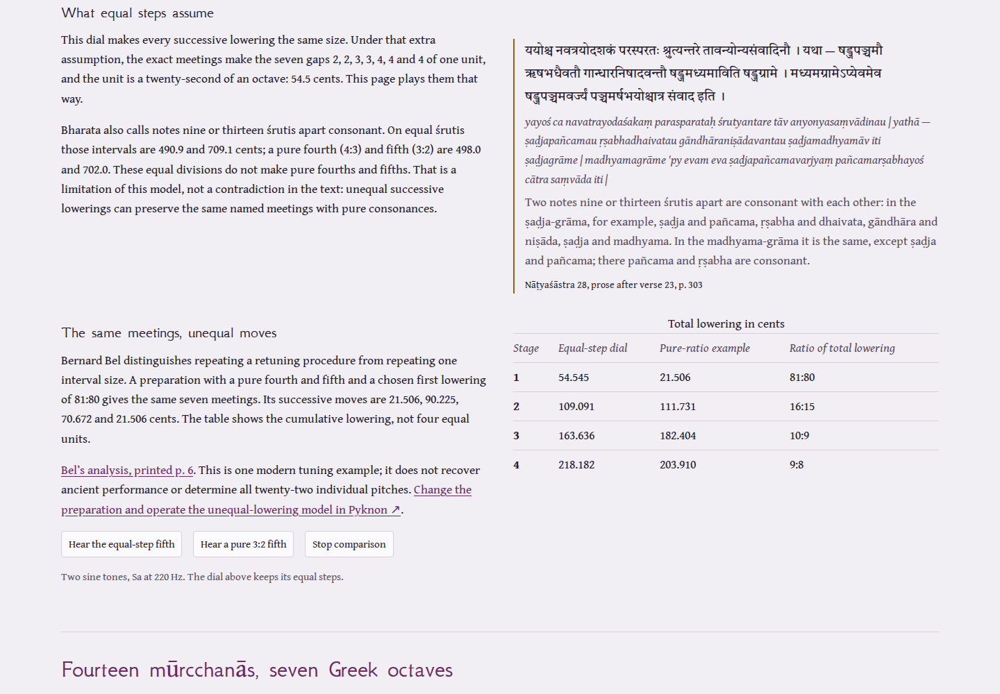

# Publication review

The initial two-vīṇā explanation overstated the equal-step dial: the named meetings
do not establish that successive lowerings have the same size. The revised page
labels that assumption explicitly and gives a counterexample, with a link to the
existing Pyknon experiment where the preparation can be varied.

## Counterexample

This modern preparation follows Bernard Bel's pure-fourth/fifth family, taking
81:80 as its first lowering. See his author-hosted
[mathematical discussion](https://bolprocessor.org/wp-content/uploads/Bharata-paper.pdf),
printed pp. 4–7 and 16–17 (1984, revised 1988 and 2020).

| Principal note | Ratio above Sa |
|---|---|
| Sa | 1:1 |
| Ri | 10:9 |
| Ga | 32:27 |
| Ma | 4:3 |
| Pa | 3:2 |
| Dha | 5:3 |
| Ni | 16:9 |

| Stage | Total lowering | New principal-note meetings |
|---|---|---|
| 1 | 81:80 | None |
| 2 | 16:15 | Ga–Ri, Ni–Dha |
| 3 | 10:9 | Ri–Sa, Dha–Pa |
| 4 | 9:8 | Sa–lower Ni, Ma–Ga, Pa–Ma |

The successive increments are 21.506, 90.225, 70.672 and 21.506 cents. These values
were independently recomputed in Python. The test uses exact integer cross-products
to check every pair and octave shift, without a cents tolerance. This verifies a
mathematical counterexample, not an ancient tuning or a twenty-two-note pitch table.

The listening comparison uses sine oscillators at explicit frequencies. This avoids
the integer delay of the plucked-string synthesizer rounding nearby targets to the
same pitch. The two fifths use 220 Hz with either 220 × 2^(13/22) Hz or 330 Hz.

The equal-step dial and its Sanskrit readings remain available. Textual uncertainty,
the third-stage lacuna and the lack of a second Sanskritist's review remain explicit.
The crossed written order alone is no longer presented as proof of a corrupt text:
the Sanskrit list does not add the English instruction “respectively”.

## Playback and browser operation

Before repair, stopping a Greek octave left later animation callbacks running.
An observed run recorded 140 SVG mutations in a 1.1-second observation beginning
300 ms after Stop. Stop now clears those callbacks and redraws the instrument;
the same observation recorded zero. Changing the tuning or species stops the old
sequence. The vīṇā page has a Stop button and stops playback when the lowering changes.

`node scripts/browser-review.mjs BASE_URL OUTPUT_DIRECTORY` exercises both pages in
Chromium and Firefox at 1440 and 375 pixels in light and dark themes. Eight contexts
selected the Greek octave, used keyboard playback, checked the stopped animation,
operated the vīṇā's last three stages, checked the exact oscillator frequencies,
and reloaded both pages offline. Accessibility checks found no WCAG A/AA violations
in those states, and there was no document overflow or uncaught page error.
[Local operation results](review/browser.json). Physical audio output was not measured.

## Offline edition

Readiness requires a controlling worker with the complete current edition. All
pages and local assets are integrity-checked during installation. External scans,
dictionaries and the linked Pyknon site need their own connection or saved edition.

`node scripts/offline-review.mjs OUTPUT_JSON` checks complete-body navigation
fallback, HTTP 503, a real 404, cache eviction and a substituted asset during
installation. Both browsers preserved the error and missing-page boundaries and
did not activate the substituted edition. [Fault results](review/offline.json).

`npm ci && npm run check` runs lint, strict TypeScript, 20 tests and a build into
`dist/`. Hosted-file comparisons and public operation receipts are separate records
in `docs/review/` after publication.
